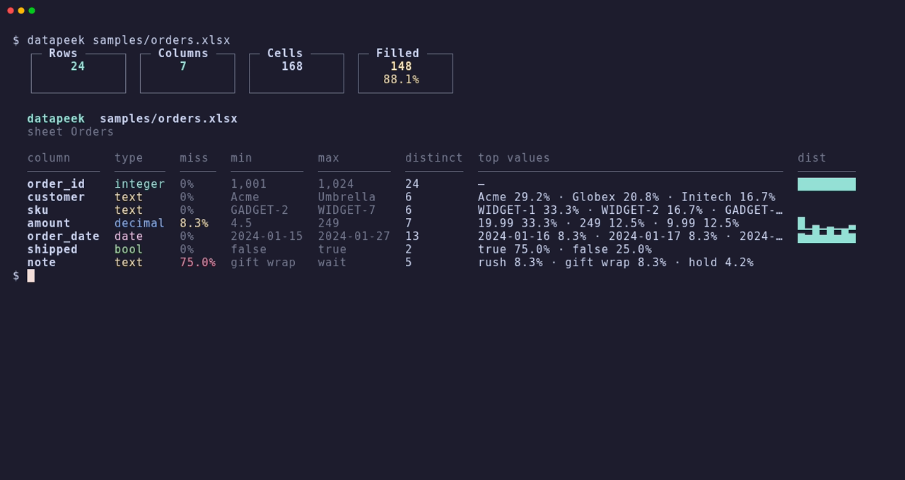

# datapeek

**See what's in a data file before you load it.**

Point datapeek at a CSV, TSV, Parquet, JSON Lines, or Excel file and get one
row per column: inferred type, missingness, range, distinct count, top
values, and a sparkline.

[](https://github.com/Jherin89/datapeek/actions/workflows/ci.yml)
[](https://github.com/Jherin89/datapeek/releases/latest)
[](LICENSE)
[](https://www.rust-lang.org)




## Features

- A column profile in one command, with no notebook and no Python environment.
- CSV, TSV, semicolon- and pipe-delimited text, Parquet, JSON Lines, and Excel (`.xlsx`, `.xlsm`, `.xls`, `.xlsb`).
- `--sheet` to pick an Excel sheet by name or by 0-based index.
- A totals panel at the top: rows, columns, cells, and how many cells are filled.
- A colored terminal table, plus `--json` for scripts.
- `--columns` to focus a profile.
- `--sample N` draws a uniform random sample of N rows from the whole file. `--seed` repeats that draw. `--head N` is the fast first-N scan.
- Built on [Polars](https://pola.rs), so a few million rows stay practical on a laptop.
- Prebuilt binaries for macOS (Apple Silicon and Intel), Linux x86_64, and Windows x86_64.

## Why datapeek

A file shows up from a partner, a pipeline dump, a Parquet landing in a
bucket, or a workbook exported from a spreadsheet, and the question is
small: what is in here? Types, holes, ranges, and whether a numeric column
is a spike or a flat line. Opening a notebook to answer that costs more
than the question.

I wrote datapeek for that moment. It is a small Rust CLI that prints the
shape of the file and gets out of the way. Use it before a warehouse load,
before you trust a schema, or whenever you want a second look without
standing up pandas.

## Getting started

v0.2.0 binaries are on the
[GitHub release](https://github.com/Jherin89/datapeek/releases/tag/v0.2.0).
Pick the archive that matches your machine. Each one unpacks to a directory
of the same name, with the `datapeek` binary, `LICENSE`, and `README.md`.

| Machine | Asset |
| --- | --- |
| macOS Apple Silicon | `datapeek-v0.2.0-aarch64-apple-darwin.tar.gz` |
| macOS Intel | `datapeek-v0.2.0-x86_64-apple-darwin.tar.gz` |
| Linux x86_64 | `datapeek-v0.2.0-x86_64-unknown-linux-gnu.tar.gz` |
| Windows x86_64 | `datapeek-v0.2.0-x86_64-pc-windows-msvc.zip` |

`datapeek --version` prints `datapeek 0.2.0`.

### macOS (Apple Silicon)

1. Download the Apple Silicon archive.

   ```bash
   curl -fL -o datapeek-v0.2.0-aarch64-apple-darwin.tar.gz \
     https://github.com/Jherin89/datapeek/releases/download/v0.2.0/datapeek-v0.2.0-aarch64-apple-darwin.tar.gz
   ```

2. Extract it.

   ```bash
   tar -xzf datapeek-v0.2.0-aarch64-apple-darwin.tar.gz
   ```

3. Clear the Gatekeeper quarantine attribute. macOS adds
   `com.apple.quarantine` to files downloaded from the internet, and an
   unsigned binary then fails with “datapeek cannot be opened because the
   developer cannot be verified.” Remove it from the binary before the first
   run:

   ```bash
   xattr -d com.apple.quarantine datapeek-v0.2.0-aarch64-apple-darwin/datapeek
   ```

   If `xattr` reports `No such xattr: com.apple.quarantine`, the file was not
   quarantined and you can continue. If macOS still blocks it, clear the
   attribute on the whole folder:

   ```bash
   xattr -dr com.apple.quarantine datapeek-v0.2.0-aarch64-apple-darwin
   ```

4. Put the binary on `PATH`. `/usr/local/bin` is already on the default PATH:

   ```bash
   sudo install -m 755 datapeek-v0.2.0-aarch64-apple-darwin/datapeek /usr/local/bin/datapeek
   ```

   Without `sudo`, install into a user directory and add it to `PATH` (zsh is
   the default shell on current macOS):

   ```bash
   mkdir -p "$HOME/.local/bin"
   install -m 755 datapeek-v0.2.0-aarch64-apple-darwin/datapeek "$HOME/.local/bin/datapeek"
   echo 'export PATH="$HOME/.local/bin:$PATH"' >> "$HOME/.zshrc"
   source "$HOME/.zshrc"
   ```

5. Check the install.

   ```bash
   datapeek --version
   ```

### macOS (Intel)

Same steps, with the Intel archive `datapeek-v0.2.0-x86_64-apple-darwin.tar.gz`
and the folder `datapeek-v0.2.0-x86_64-apple-darwin`.

```bash
curl -fL -o datapeek-v0.2.0-x86_64-apple-darwin.tar.gz \
  https://github.com/Jherin89/datapeek/releases/download/v0.2.0/datapeek-v0.2.0-x86_64-apple-darwin.tar.gz
tar -xzf datapeek-v0.2.0-x86_64-apple-darwin.tar.gz
xattr -d com.apple.quarantine datapeek-v0.2.0-x86_64-apple-darwin/datapeek
sudo install -m 755 datapeek-v0.2.0-x86_64-apple-darwin/datapeek /usr/local/bin/datapeek
datapeek --version
```

### Linux (x86_64)

The Linux asset is a gzip-compressed tar. There is no quarantine attribute.

```bash
curl -fL -o datapeek-v0.2.0-x86_64-unknown-linux-gnu.tar.gz \
  https://github.com/Jherin89/datapeek/releases/download/v0.2.0/datapeek-v0.2.0-x86_64-unknown-linux-gnu.tar.gz
tar -xzf datapeek-v0.2.0-x86_64-unknown-linux-gnu.tar.gz
sudo install -m 755 datapeek-v0.2.0-x86_64-unknown-linux-gnu/datapeek /usr/local/bin/datapeek
datapeek --version
```

For a user install instead of `/usr/local/bin`:

```bash
mkdir -p "$HOME/.local/bin"
install -m 755 datapeek-v0.2.0-x86_64-unknown-linux-gnu/datapeek "$HOME/.local/bin/datapeek"
export PATH="$HOME/.local/bin:$PATH"
datapeek --version
```

Add that `export` to your shell profile if you want it in new terminals.
`~/.local/bin` is not always on `PATH` by default.

### Windows (x86_64)

The Windows asset is a real zip (a Deflate archive with a `PK` header).
Extract it with `Expand-Archive`. `unzip` works too. Do not extract it with
`tar`.

1. Download the zip in PowerShell.

   ```powershell
   Invoke-WebRequest `
     -Uri https://github.com/Jherin89/datapeek/releases/download/v0.2.0/datapeek-v0.2.0-x86_64-pc-windows-msvc.zip `
     -OutFile datapeek-v0.2.0-x86_64-pc-windows-msvc.zip
   ```

2. Extract it. This creates `datapeek-v0.2.0-x86_64-pc-windows-msvc\`
   containing `datapeek.exe`, `LICENSE`, and `README.md`.

   ```powershell
   Expand-Archive -Path datapeek-v0.2.0-x86_64-pc-windows-msvc.zip -DestinationPath .
   ```

3. Confirm the binary before changing `PATH`.

   ```powershell
   .\datapeek-v0.2.0-x86_64-pc-windows-msvc\datapeek.exe --version
   ```

4. Add that folder to your user `Path`, then open a new terminal so the
   change is picked up.

   ```powershell
   $dir = (Resolve-Path .\datapeek-v0.2.0-x86_64-pc-windows-msvc).Path
   $userPath = [Environment]::GetEnvironmentVariable('Path', 'User')
   if ($userPath -notlike "*$dir*") {
     [Environment]::SetEnvironmentVariable('Path', "$userPath;$dir", 'User')
   }
   ```

5. In the new terminal:

   ```powershell
   datapeek --version
   ```

### From source with cargo

This needs Rust 1.89 or newer. `rust-toolchain.toml` tracks the stable
channel and includes rustfmt and clippy, so a rustup-managed toolchain uses
the current stable compiler. The crate's minimum supported version is 1.89.

Install Rust from <https://rustup.rs> if you do not already have it.

macOS or Linux:

```bash
curl --proto '=https' --tlsv1.2 -sSf https://sh.rustup.rs | sh
source "$HOME/.cargo/env"
rustc --version
```

Windows: download `rustup-init.exe` from <https://rustup.rs> and run it, or
`winget install Rustlang.Rustup`. Open a new terminal afterward so `cargo` is
on `PATH`.

Then install datapeek from this repository:

```bash
cargo install --git https://github.com/Jherin89/datapeek --tag v0.2.0
datapeek --version
```

`cargo install` puts the binary in `~/.cargo/bin` (or `%USERPROFILE%\.cargo\bin`
on Windows), which rustup adds to `PATH`.

### Build from source

Clone the tag and build the release binary. This is the same compiler
requirement as `cargo install`: Rust 1.89 or newer, with the repo toolchain
file selecting stable.

macOS or Linux:

```bash
git clone https://github.com/Jherin89/datapeek
cd datapeek
git checkout v0.2.0
cargo build --release
sudo install -m 755 target/release/datapeek /usr/local/bin/datapeek
datapeek --version
```

Windows (PowerShell), after Rust is on `PATH`:

```powershell
git clone https://github.com/Jherin89/datapeek
cd datapeek
git checkout v0.2.0
cargo build --release
.\target\release\datapeek.exe --version
```

Copy `target\release\datapeek.exe` onto your user `Path` the same way as the
downloaded zip, or run it from that path.

## Usage

### First run

The repo includes small files in [`samples/`](samples/): `orders.csv`,
`events.tsv`, `orders.parquet`, `metrics.jsonl`, and `orders.xlsx` (sheets
`Orders`, `Returns`, and `Types`).

```bash
datapeek samples/orders.csv
```

On a terminal, the totals panel and the table are colored. Row and column
counts are cyan. Filled turns green at 95%, yellow from 80%, and red below
that. In the table, types are tinted, missingness turns yellow at 5% and red
at 20%, and sparklines are cyan. The text form of that profile is:

```
  ┌─ Rows ─────┐ ┌─ Columns ──┐ ┌─ Cells ────┐ ┌─ Filled ───┐
  │     24     │ │     7      │ │    168     │ │    148     │
  │            │ │            │ │            │ │   88.1%    │
  └────────────┘ └────────────┘ └────────────┘ └────────────┘

  datapeek  samples/orders.csv

  column      type     miss   min         max         distinct  top values                                  dist
  ──────────  ───────  ─────  ──────────  ──────────  ────────  ──────────────────────────────────────────  ────────
  order_id    integer  0%     1,001       1,024       24        —                                           ████████
  customer    text     0%     Acme        Umbrella    6         Acme 29.2% · Globex 20.8% · Initech 16.7%
  sku         text     0%     GADGET-2    WIDGET-7    6         WIDGET-1 33.3% · WIDGET-2 16.7% · GADGET-…
  amount      decimal  8.3%   4.5         249         7         19.99 33.3% · 249 12.5% · 9.99 12.5%        █▁▃▁▂▁▁▃
  order_date  date     0%     2024-01-15  2024-01-27  13        2024-01-16 8.3% · 2024-01-17 8.3% · 2024-…  ▆▅█▅█▅█▆
  shipped     bool     0%     false       true        2         true 75.0% · false 25.0%
  note        text     75.0%  gift wrap   wait        5         rush 8.3% · gift wrap 8.3% · hold 4.2%
```

The panel is the shape of the profiled data. **Rows** and **Columns** are the
profiled frame. **Cells** is rows × columns. **Filled** is the cells that
are not null and not an empty string, with that count as a percent of cells.
`orders.csv` has 168 cells and 20 missing (2 in `amount`, 18 in `note`), so
148 are filled (88.1%). An empty table (0 rows or 0 columns) shows 0 cells
and 0% filled.

A cell is missing when it is null or `""`. That is the same rule as the
**miss** column: filled cells equal cells minus the sum of the per-column
missing counts. CSV and TSV empty fields, quoted `""`, JSON Lines `""`,
Excel empty cells and empty-string cells, and Parquet empty strings all
count. A value that is only whitespace, such as `" "`, is data.

Under the panel is the file path. An Excel profile adds the sheet on the
next line (`sheet Orders`). `--head` and `--sample` name the rows they
actually profiled. `--head 5` says `Profiled · first 5 rows` and labels the
first card **First rows**. `--sample 5 --seed 1` says
`Profiled · random sample of 5 rows (seed 1) · of 24 rows` and labels the
first card **Sampled rows**, with `of 24` under the count. The seed phrase
is omitted when you do not pass `--seed`. The file total (`of 24`) appears
when datapeek already knew it: a Parquet footer, the rows a random sample
streamed, or an Excel sheet already in memory. `--head` on CSV or JSON
Lines does not walk the rest of the file just to count it, so that total
is left out. When the requested row count covers the whole file, the panel
is the full-read form and `mode` in the JSON is `full`.

The cards use the terminal width, or `COLUMNS` when stdout is not a
terminal, or 80 when neither is known. If the boxes would wrap, datapeek
prints stacked lines instead:

```
  Rows     24
  Columns  7
  Cells    168
  Filled   148 (88.1%)
```

`NO_COLOR`, and any run whose stdout is not a terminal, prints the same
text without color.

The other samples:

```bash
datapeek samples/events.tsv
datapeek samples/orders.parquet
datapeek samples/metrics.jsonl
datapeek samples/orders.xlsx
```

### Reading the table

| Column | Meaning |
| --- | --- |
| **column** | Field name from the header, the Parquet/JSON schema, or the first row of an Excel sheet. |
| **type** | `integer`, `decimal`, `date`, `bool`, or `text`. |
| **miss** | Percent of profiled rows that are null or an empty string. Whitespace-only text is data. `0%` when nothing is missing, `<0.1%` for a tiny share, one decimal otherwise. |
| **min / max** | Range. Text is lexicographic. The table prints thousands separators (`1,001`). `--json` emits numeric bounds as JSON numbers (`1001`). |
| **distinct** | Number of unique values, including a single null bucket when nulls are present. |
| **top values** | Up to three most common values, with each value's share of all rows. `—` when the column is empty or every non-null value is unique and there are more than three of them. Long values are truncated with `…`. |
| **dist** | An 8-bin sparkline for `integer`, `decimal`, and `date` columns. Text and bool columns leave this blank. |

### Flags

```
datapeek [OPTIONS] <FILE>
```

| Flag | What it does |
| --- | --- |
| `<FILE>` | Data file to profile. Required. |
| `--json` | Pretty-printed JSON profile instead of the table. |
| `--strict` | Fail on CSV/TSV parsing errors or Excel error cells. Writes no profile on failure. |
| `--verbose` | Include technical details for CSV/TSV parsing errors. |
| `-c, --columns <COLS>` | Comma-separated column names to keep, in the order you list them. |
| `--sample <N>` | Uniform random sample of N rows from the whole file. If N is at least the row count, every row is used and the profile is a full read. Cannot be combined with `--head`. |
| `--seed <SEED>` | `u64` seed for `--sample`. The same seed profiles the same rows. Requires `--sample`. Omit it and each run draws a new sample. |
| `--head <N>` | Profile the first N rows and stop scanning. Cannot be combined with `--sample`. |
| `--sheet <NAME\|INDEX>` | Excel sheet to profile. An exact sheet name wins, even when that name is numeric. Otherwise a value that parses as an integer is a 0-based index (`01` is index 1). The default is the first sheet. On a non-Excel file this flag is an error. |
| `-h, --help` | Print help. |
| `-V, --version` | Print `datapeek 0.3.0`. |

**`--json`.** Same profile as the table. Numeric min/max are raw JSON numbers.
`histogram` and `sparkline` are present only for numeric and date columns.
`rows` and `columns` are the profiled frame. `cells` is `rows * columns`
(0 when either side is 0). `filled_cells` counts cells that are not null and
not `""`. `filled_pct` is `100 * filled_cells / cells`, the same full-precision
ratio as `missing_pct`, or `0` when there are no cells. `file_rows` is the
row count of the whole file when that number was already known, and `null`
when it was not (a CSV or JSON Lines `--head`). `mode` is `full`, `head`, or
`random`. `seed` is the `--seed` value, or `null` when you did not pass one.
`sampled` is true only for a strict subset (`head` or `random`).
`sample_limit` is the N you asked for, and it is omitted when the profile
covers the whole file. `sheet` is present for Excel. `warnings` is present
only when parsing problems were tolerated. Each warning has a stable `code`
and a `message`, with a `column` when available. Excel warnings also have an
exact error-cell `count`. CSV warnings omit the count because the reader
does not expose it. Warnings also appear on stderr, leaving stdout as valid
JSON.

```bash
datapeek --json samples/orders.csv
```

Full pretty-printed output of that command:

<details>
<summary><code>datapeek --json samples/orders.csv</code></summary>

```json
{
  "file": "samples/orders.csv",
  "rows": 24,
  "columns": 7,
  "cells": 168,
  "filled_cells": 148,
  "filled_pct": 88.0952380952381,
  "file_rows": 24,
  "sampled": false,
  "mode": "full",
  "seed": null,
  "format": "csv",
  "profile": [
    {
      "name": "order_id",
      "type": "integer",
      "missing_pct": 0.0,
      "min": 1001,
      "max": 1024,
      "distinct": 24,
      "top_values": [],
      "histogram": [
        3,
        3,
        3,
        3,
        3,
        3,
        3,
        3
      ],
      "sparkline": "████████"
    },
    {
      "name": "customer",
      "type": "text",
      "missing_pct": 0.0,
      "min": "Acme",
      "max": "Umbrella",
      "distinct": 6,
      "top_values": [
        {
          "value": "Acme",
          "count": 7,
          "pct": 29.166666666666668
        },
        {
          "value": "Globex",
          "count": 5,
          "pct": 20.833333333333332
        },
        {
          "value": "Initech",
          "count": 4,
          "pct": 16.666666666666668
        }
      ]
    },
    {
      "name": "sku",
      "type": "text",
      "missing_pct": 0.0,
      "min": "GADGET-2",
      "max": "WIDGET-7",
      "distinct": 6,
      "top_values": [
        {
          "value": "WIDGET-1",
          "count": 8,
          "pct": 33.333333333333336
        },
        {
          "value": "WIDGET-2",
          "count": 4,
          "pct": 16.666666666666668
        },
        {
          "value": "GADGET-9",
          "count": 4,
          "pct": 16.666666666666668
        }
      ]
    },
    {
      "name": "amount",
      "type": "decimal",
      "missing_pct": 8.333333333333334,
      "min": 4.5,
      "max": 249.0,
      "distinct": 7,
      "top_values": [
        {
          "value": "19.99",
          "count": 8,
          "pct": 33.333333333333336
        },
        {
          "value": "249",
          "count": 3,
          "pct": 12.5
        },
        {
          "value": "9.99",
          "count": 3,
          "pct": 12.5
        }
      ],
      "histogram": [
        14,
        0,
        3,
        0,
        2,
        0,
        0,
        3
      ],
      "sparkline": "█▁▃▁▂▁▁▃"
    },
    {
      "name": "order_date",
      "type": "date",
      "missing_pct": 0.0,
      "min": "2024-01-15",
      "max": "2024-01-27",
      "distinct": 13,
      "top_values": [
        {
          "value": "2024-01-16",
          "count": 2,
          "pct": 8.333333333333334
        },
        {
          "value": "2024-01-17",
          "count": 2,
          "pct": 8.333333333333334
        },
        {
          "value": "2024-01-18",
          "count": 2,
          "pct": 8.333333333333334
        }
      ],
      "histogram": [
        3,
        2,
        4,
        2,
        4,
        2,
        4,
        3
      ],
      "sparkline": "▆▅█▅█▅█▆"
    },
    {
      "name": "shipped",
      "type": "bool",
      "missing_pct": 0.0,
      "min": "false",
      "max": "true",
      "distinct": 2,
      "top_values": [
        {
          "value": "true",
          "count": 18,
          "pct": 75.0
        },
        {
          "value": "false",
          "count": 6,
          "pct": 25.0
        }
      ]
    },
    {
      "name": "note",
      "type": "text",
      "missing_pct": 75.0,
      "min": "gift wrap",
      "max": "wait",
      "distinct": 5,
      "top_values": [
        {
          "value": "rush",
          "count": 2,
          "pct": 8.333333333333334
        },
        {
          "value": "gift wrap",
          "count": 2,
          "pct": 8.333333333333334
        },
        {
          "value": "hold",
          "count": 1,
          "pct": 4.166666666666667
        }
      ]
    }
  ]
}
```

</details>

`amount` in that file is `"min": 4.5` and `"max": 249.0`. Text, dates, and
bools stay strings (`"min": "Acme"`, `"min": "2024-01-15"`, `"min": "false"`).

**`--columns`.** Names that are not in the file are an error. Order follows
the flag, not the file.

```bash
datapeek --columns customer,amount samples/orders.csv
```

```
  ┌─ Rows ─────┐ ┌─ Columns ──┐ ┌─ Cells ────┐ ┌─ Filled ───┐
  │     24     │ │     2      │ │     48     │ │     46     │
  │            │ │            │ │            │ │   95.8%    │
  └────────────┘ └────────────┘ └────────────┘ └────────────┘

  datapeek  samples/orders.csv

  column    type     miss  min   max       distinct  top values                                 dist
  ────────  ───────  ────  ────  ────────  ────────  ─────────────────────────────────────────  ────────
  customer  text     0%    Acme  Umbrella  6         Acme 29.2% · Globex 20.8% · Initech 16.7%
  amount    decimal  8.3%  4.5   249       7         19.99 33.3% · 249 12.5% · 9.99 12.5%       █▁▃▁▂▁▁▃
```

**Excel.** `.xlsx`, `.xlsm`, `.xls`, and `.xlsb` are detected by extension.
The first sheet is the default. The first row is the header. Cells become
integers, decimals, bools, or dates. An Excel date with a time of day is a
datetime (still reported as `date`, with `YYYY-MM-DD HH:MM:SS` bounds). A
column that mixes those types falls back to text. Empty cells and empty
strings are null. `samples/orders.xlsx` sheet `Orders` matches
`samples/orders.csv`:

```bash
datapeek samples/orders.xlsx
```

```
  ┌─ Rows ─────┐ ┌─ Columns ──┐ ┌─ Cells ────┐ ┌─ Filled ───┐
  │     24     │ │     7      │ │    168     │ │    148     │
  │            │ │            │ │            │ │   88.1%    │
  └────────────┘ └────────────┘ └────────────┘ └────────────┘

  datapeek  samples/orders.xlsx
  sheet Orders

  column      type     miss   min         max         distinct  top values                                  dist
  ──────────  ───────  ─────  ──────────  ──────────  ────────  ──────────────────────────────────────────  ────────
  order_id    integer  0%     1,001       1,024       24        —                                           ████████
  customer    text     0%     Acme        Umbrella    6         Acme 29.2% · Globex 20.8% · Initech 16.7%
  sku         text     0%     GADGET-2    WIDGET-7    6         WIDGET-1 33.3% · WIDGET-2 16.7% · GADGET-…
  amount      decimal  8.3%   4.5         249         7         19.99 33.3% · 249 12.5% · 9.99 12.5%        █▁▃▁▂▁▁▃
  order_date  date     0%     2024-01-15  2024-01-27  13        2024-01-16 8.3% · 2024-01-17 8.3% · 2024-…  ▆▅█▅█▅█▆
  shipped     bool     0%     false       true        2         true 75.0% · false 25.0%
  note        text     75.0%  gift wrap   wait        5         rush 8.3% · gift wrap 8.3% · hold 4.2%
```

**`--sheet`.** A value that equals a sheet name exactly wins, including a
numeric name. Otherwise an integer is a 0-based index, so `--sheet 1` is the
second sheet and `--sheet Returns` is the same sheet by name. An unknown
sheet exits 1 and lists the names that exist.

```bash
datapeek --sheet Returns samples/orders.xlsx
datapeek --sheet 1 samples/orders.xlsx
```

```
  ┌─ Rows ─────┐ ┌─ Columns ──┐ ┌─ Cells ────┐ ┌─ Filled ───┐
  │     3      │ │     5      │ │     15     │ │     14     │
  │            │ │            │ │            │ │   93.3%    │
  └────────────┘ └────────────┘ └────────────┘ └────────────┘

  datapeek  samples/orders.xlsx
  sheet Returns

  column       type     miss   min                  max                  distinct  top values                                  dist
  ───────────  ───────  ─────  ───────────────────  ───────────────────  ────────  ──────────────────────────────────────────  ────────
  return_id    integer  0%     1                    3                    3         1 33.3% · 2 33.3% · 3 33.3%                 █▁▁▁█▁▁█
  order_id     integer  0%     1,002                1,015                3         1,002 33.3% · 1,011 33.3% · 1,015 33.3%     █▁▁▁▁█▁█
  reason       text     0%     damaged              wrong item           3         damaged 33.3% · wrong item 33.3% · late 3…
  refund       integer  33.3%  10                   249                  3         249 33.3% · 10 33.3%                        █▁▁▁▁▁▁█
  received_at  date     0%     2024-02-01 09:30:00  2024-02-03 00:00:00  3         2024-02-01 09:30:00 33.3% · 2024-02-02 15…  █▁▁▁▁▁██
```

`refund` is an integer because both populated cells are whole numbers, and
one cell is empty (33.3% missing). `received_at` keeps the time of day.
`--sheet` on a CSV, TSV, Parquet, or JSON Lines file is an error. `--columns`,
`--json`, `--sample`, `--head`, and `--seed` work on a sheet the same way
they work on a text file.

**`--sample`.** A uniform draw of N rows from the whole file, not a prefix.
Pass `--seed` when you want the same rows again. The panel names the mode
and, when you passed one, the seed. The row card is the sample size, and
`of 24` is the file, because the sampler already counted every row. On
`orders.csv` the ids are sorted, so a sample of 5 with seed 1 is not the
first five orders (`order_id` runs 1,007–1,022 here, not 1,001–1,005):

```bash
datapeek --sample 5 --seed 1 samples/orders.csv
```

```
  Profiled · random sample of 5 rows (seed 1) · of 24 rows
  ┌─ Sampled rows ─┐ ┌─ Columns ──────┐ ┌─ Cells ────────┐ ┌─ Filled ───────┐
  │       5        │ │       7        │ │       35       │ │       31       │
  │     of 24      │ │                │ │                │ │     88.6%      │
  └────────────────┘ └────────────────┘ └────────────────┘ └────────────────┘

  datapeek  samples/orders.csv
  random sample of 5 rows (seed 1) · of 24 rows

  column      type     miss   min         max         distinct  top values                                  dist
  ──────────  ───────  ─────  ──────────  ──────────  ────────  ──────────────────────────────────────────  ────────
  order_id    integer  0%     1,007       1,022       5         —                                           █▁▁███▁█
  customer    text     0%     Globex      Initech     3         Initech 40.0% · Hooli 40.0% · Globex 20.0%
  sku         text     0%     WIDGET-1    WIDGET-3    3         WIDGET-1 40.0% · WIDGET-3 40.0% · WIDGET-…
  amount      decimal  0%     4.5         249         3         19.99 40.0% · 4.5 40.0% · 249 20.0%         █▁▁▁▁▁▁▃
  order_date  date     0%     2024-01-18  2024-01-26  4         2024-01-23 40.0% · 2024-01-18 20.0% · 202…  ▅▁▁▅▁█▁▅
  shipped     bool     0%     false       true        2         true 80.0% · false 20.0%
  note        text     80.0%  hold        hold        2         hold 20.0%
```

The JSON for that command sets `"sampled": true`, `"sample_limit": 5`,
`"mode": "random"`, `"seed": 1`, and `"file_rows": 24`. `rows` stays 5,
the rows that were profiled. If N is at least the number of rows, every row
is used, `sampled` is false, `sample_limit` is omitted, and `mode` is
`full`.

**`--head`.** The fast prefix. Scanning stops after N rows. Same file, first
five rows. The panel says these are the first 5 rows. A CSV prefix leaves
the file total out, because counting the rest of the file would be another
pass:

```bash
datapeek --head 5 samples/orders.csv
```

```
  Profiled · first 5 rows
  ┌─ First rows ─┐ ┌─ Columns ────┐ ┌─ Cells ──────┐ ┌─ Filled ─────┐
  │      5       │ │      7       │ │      35      │ │      31      │
  │              │ │              │ │              │ │    88.6%     │
  └──────────────┘ └──────────────┘ └──────────────┘ └──────────────┘

  datapeek  samples/orders.csv
  first 5 rows

  column      type     miss   min         max         distinct  top values                                  dist
  ──────────  ───────  ─────  ──────────  ──────────  ────────  ──────────────────────────────────────────  ────────
  order_id    integer  0%     1,001       1,005       5         —                                           █▁█▁█▁██
  customer    text     0%     Acme        Umbrella    4         Acme 40.0% · Globex 20.0% · Initech 20.0%
  sku         text     0%     GADGET-9    WIDGET-7    4         WIDGET-1 40.0% · WIDGET-2 20.0% · GADGET-…
  amount      decimal  20.0%  9.99        249         4         —                                           █▁▁▁▁▁▁▃
  order_date  date     0%     2024-01-15  2024-01-17  3         2024-01-16 40.0% · 2024-01-17 40.0% · 202…  ▅▁▁▁█▁▁█
  shipped     bool     0%     false       true        2         true 80.0% · false 20.0%
  note        text     60.0%  gift wrap   rush        3         rush 20.0% · gift wrap 20.0%
```

`--sample` and `--head` together are rejected (exit 2). `--seed` without
`--sample` is rejected (exit 2). `N` of 0 exits 1 with `row limit must be at
least 1`.

### Formats

| Format | How datapeek recognizes it |
| --- | --- |
| **CSV** | `.csv`. The delimiter is sniffed from the first lines: comma, tab, semicolon, or pipe. The separator with a stable column count wins. |
| **TSV** | `.tsv` or `.tab` is always tab-separated. A `.csv` that is actually tabs is sniffed as TSV. |
| **Parquet** | `.parquet` or `.pq`, or a file whose first bytes are the `PAR1` magic. |
| **JSON Lines** | `.jsonl`, `.ndjson`, or `.json`. A file with no extension is treated as JSON Lines when the first non-empty line starts with `{` or `[`. |
| **Excel** | `.xlsx`, `.xlsm`, `.xls`, or `.xlsb`. The first sheet is profiled unless you pass `--sheet`. The first row is the header. |
| **Extensionless text** | Sniffed as Parquet, then JSON Lines, then a delimited table. |

OpenDocument spreadsheets (`.ods`) are rejected. Dates in delimited files are
parsed when they look like `YYYY-MM-DD`,
`MM/DD/YYYY`, `DD/MM/YYYY`, or an ISO datetime. A string column whose values
are all integers, decimals, or booleans is reported as that type.

A file that is not actually the format it claims to be exits `1` with
`datapeek: failed to parse …`. A delimited row with more fields than the
header is a parse error too.

### Exit codes and errors

By default, CSV/TSV parsing first tries a strict read. If it fails and a
tolerant read succeeds, datapeek writes the profile and a warning:

```text
datapeek: warning: Profile created, but some CSV values could not be read and are counted as missing. Run with --strict to see the problem and stop instead.
```

Excel error cells remain included in missingness for compatibility. A warning
counts them separately from blanks, per selected column, and identifies the
first error cell:

```text
datapeek: warning: Profile created with 1 Excel error cell counted as missing in column 'amount' (sheet 'Sheet1', first at A3: #DIV/0!). Fix the cell in Excel, then save the workbook and try again.
```

With `--strict`, these problems exit `1`, write the error to stderr, and
write no profile to stdout. Genuine blank cells are allowed. Strict mode
checks parsing against inferred types; it does not enforce a business schema.
For example, a column inferred as text can contain both numbers and words.

CSV value errors show the column, its inferred value type in plain language,
and a preview of the offending value. They also show a command to inspect the
same input without strict mode. Excel errors show the sheet, column, and
absolute worksheet cell address. The retry command preserves the current
options and quotes file paths for PowerShell on Windows or a POSIX shell on
macOS/Linux. CSV parser details are available with `--verbose`.

With `--head`, CSV value checks cover only the first N records. With
`--sample`, they cover the sampled records; sampling still scans the file
and can fail on malformed record structure outside the sample. CSV readers
validate every loaded column, including columns omitted by `--columns`.
Excel checks error cells only in the selected data rows and columns of the
selected sheet. Header cells are used to form column names. A successful
partial profile does not certify the rest of the file.

```bash
datapeek --strict samples/orders.csv
datapeek --strict --json --sheet Orders samples/orders.xlsx
```

| Exit | When |
| --- | --- |
| `0` | The profile was written. Closing the pipe early, as in `datapeek file \| head`, is also success. |
| `1` | A datapeek error. The message is on stderr and starts with `datapeek: `. |
| `2` | The arguments are wrong (missing file, `--sample` is not a number, `--sample` combined with `--head`, or `--seed` without `--sample`). This comes from the argument parser. |

```text
datapeek: no such file: /tmp/no-such-datapeek.csv
datapeek: is a directory: samples
datapeek: file is empty: /tmp/empty-datapeek.csv
datapeek: unknown column 'nope' (have: order_id, customer, sku, amount, order_date, shipped, note)
datapeek: unknown sheet 'Missing' (have: Orders, Returns, Types)
datapeek: --sheet only applies to Excel files (.xlsx, .xlsm, .xls, .xlsb); 'samples/orders.csv' is csv
datapeek: unsupported file 'book.ods': OpenDocument spreadsheets are not supported (try CSV, TSV, Parquet, JSON Lines, or Excel)
datapeek: row limit must be at least 1
datapeek: failed to parse '/tmp/bad.parquet': parquet: File out of specification: The file must end with PAR1: 'parquet scan'
```

A missing `<FILE>` exits 2:

```text
error: the following required arguments were not provided:
  <FILE>
```

### Recipes

**Check a CSV before a warehouse load.** Look for columns that are mostly
empty, types you did not expect (an id that arrived as text, a date that
stayed text), and a distinct count of 1 on a column you thought varied.

```bash
datapeek --json samples/orders.csv \
  | jq '[.profile[] | select(.missing_pct > 0) | {name, type, missing_pct}]'
```

```json
[
  {
    "name": "amount",
    "type": "decimal",
    "missing_pct": 8.333333333333334
  },
  {
    "name": "note",
    "type": "text",
    "missing_pct": 75.0
  }
]
```

**Script a profile with jq.** `--json` is pretty-printed. `jq -c` gives one
object per column, which is easy to grep or load elsewhere.

```bash
datapeek --json samples/orders.csv \
  | jq -c '.profile[] | {name, type, missing_pct, min, max}'
```

```json
{"name":"order_id","type":"integer","missing_pct":0.0,"min":1001,"max":1024}
{"name":"customer","type":"text","missing_pct":0.0,"min":"Acme","max":"Umbrella"}
{"name":"sku","type":"text","missing_pct":0.0,"min":"GADGET-2","max":"WIDGET-7"}
{"name":"amount","type":"decimal","missing_pct":8.333333333333334,"min":4.5,"max":249.0}
{"name":"order_date","type":"date","missing_pct":0.0,"min":"2024-01-15","max":"2024-01-27"}
{"name":"shipped","type":"bool","missing_pct":0.0,"min":"false","max":"true"}
{"name":"note","type":"text","missing_pct":75.0,"min":"gift wrap","max":"wait"}
```

**Peek at a large file.** `--head` stops after the first rows, which is the
quick look. `--sample` with a seed is a repeatable draw from the whole file.

```bash
datapeek --head 100000 huge.csv
datapeek --sample 100000 --seed 1 huge.csv
```

**Profile one measure.**

```bash
datapeek --columns amount,order_date samples/orders.csv
```

## Performance

A full read of a delimited or Parquet file is a Polars lazy scan. `--head`
stops that scan after N rows. `--sample` streams the file (CSV and JSON
Lines) or reads only the Parquet row groups that hold the chosen indexes,
then profiles those rows. A few million rows on a laptop is the design point.

Measured on Linux x86_64 with `target/release/datapeek`, warm page cache,
median of three runs after one warmup. The file is 2,000,000 rows × 7
columns of CSV (about 91 MiB) and is not in the repo.

| Command | Median | The three runs |
| --- | --- | --- |
| `datapeek bench-2m.csv` | **0.59 s** | 0.583 s, 0.590 s, 0.613 s |
| `datapeek --sample 100000 --seed 1 bench-2m.csv` | **0.50 s** | 0.503 s, 0.498 s, 0.498 s |
| `datapeek --head 100000 bench-2m.csv` | **0.24 s** | 0.244 s, 0.231 s, 0.239 s |

v0.1 measured 0.67 s for a full profile of the same shape, and 0.17 s when
`--sample` still meant the first 100,000 rows. The full-file path is still
that lazy scan.

## How it works

Polars infers a schema from CSV, TSV, Parquet, and JSON Lines. String columns
get an extra pass so dates and bools are not left as text. Before those
stats, an empty string is turned into null, so missingness, min/max, distinct
counts, top values, and the filled total agree. Columns with no `""` skip
that copy. Whitespace-only text stays. Missingness, min/max, and distinct
counts are vectorized aggregations. Top values come from `value_counts`.
Numeric and date histograms are an 8-bin pass used only to draw the
sparkline. Filled cells are the profiled cells minus the sum of those
per-column missing counts.

Excel is read with [calamine](https://github.com/tafia/calamine). The chosen
sheet is already in memory, so sampling picks row indexes out of that sheet
and the file row count is known without another pass. Each column is typed
from its cells. Whole numbers (including integral Excel floats) become
integers, other finite numbers become decimals, and bools stay bools. A
midnight Excel date stays a date. Any other time of day becomes a datetime.
Both are shown as `date`. A column that mixes incompatible types becomes
text. Empty cells, empty strings, and error cells are null.

`--sample` uses reservoir sampling (Algorithm R, seeded with `rand`'s
StdRng). CSV keeps the sampled records and parses only those rows with the
same Polars reader as a full scan. JSON Lines does the same with the sampled
lines. Parquet reads the row groups that intersect the chosen indexes, then
takes those rows. When N covers the file, datapeek uses the normal full-file
loader so the profile matches an unsampled run. `--head` asks the reader to
stop after N rows.

## Development

Rust 1.89 or newer. `rust-toolchain.toml` tracks stable.

```bash
cargo test
cargo run --release -- samples/orders.csv
cargo run --example gen_parquet    # regenerate samples/orders.parquet
cargo run --example gen_xlsx       # regenerate samples/orders.xlsx
```

History of user-facing changes is in [CHANGELOG.md](CHANGELOG.md).

CI runs `fmt` and `clippy` on Ubuntu, and `cargo test` on Ubuntu, macOS, and
Windows, for every push and pull request. Pushing a `v*` tag builds release
archives and attaches them to the GitHub Release:

- `datapeek-<tag>-aarch64-apple-darwin.tar.gz`
- `datapeek-<tag>-x86_64-apple-darwin.tar.gz`
- `datapeek-<tag>-x86_64-unknown-linux-gnu.tar.gz`
- `datapeek-<tag>-x86_64-pc-windows-msvc.zip` — a real Deflate zip, built with 7-Zip and checked for a `PK` header. Extract it with `Expand-Archive` (or `unzip`). It contains `datapeek.exe`, `LICENSE`, and `README.md`.

The GIF at the top is `docs/demo.tape`, recorded with
[vhs](https://github.com/charmbracelet/vhs). The still above it is
`docs/screenshot.tape` (`datapeek samples/orders.xlsx`). From the repo root,
with `jq` and a release build on `PATH`:

```bash
export PATH="$PWD/target/release:$PATH"
vhs docs/demo.tape
vhs docs/screenshot.tape
```

## License

MIT © Jordan Herin
